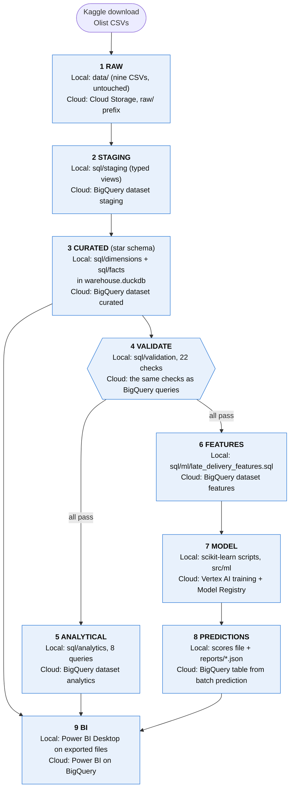

# Retail Analytics, Forecasting & Customer Intelligence

An end-to-end analytics project on about 100,000 real e-commerce orders (the Olist dataset from Brazil): a validated data warehouse, business analysis, a late-delivery prediction model, a weekly forecast and a Power BI dashboard. It runs entirely on one laptop with DuckDB, and every claim in it can be traced to a saved table, a test or a query.

It began as a Google Cloud design (BigQuery, Dataflow, Vertex AI). Early on that was cut down to a local build, because the data is small and a cloud bill would have bought nothing. The original brief is kept unchanged in `Cloud Portfolio — Master Agent Prompt.md`, `GCP Retail Project Local vs Cloud Architecture.md` and the Retail Analytics project document, in case parts of it return. Why the scope changed, and everything else that was decided along the way, is in [DECISIONS.md](DECISIONS.md).

## What the data says

- **The business** ([docs/analytics/BUSINESS_INSIGHTS.md](docs/analytics/BUSINESS_INSIGHTS.md)): net revenue of R$ 13.5 million across 98,199 orders. About 97% of customers buy only once, so this is an acquisition business, not a loyalty one. Late deliveries are the clearest driver of bad reviews: orders that arrive late average a review score of 2.57, against 4.29 for the rest.
- **A surprise worth the whole discovery phase:** in 2018 the delivery *promise* was shortened sharply (75% of August orders were promised in under 20 days). Deliveries actually got faster, yet more orders counted as late, because the estimate moved faster than the service did.
- **The late-delivery model** ([docs/ml/MODEL_CARD.md](docs/ml/MODEL_CARD.md)): given only what is known when an order is placed, flagging the riskiest 10% of orders catches late deliveries about 2.8 times better than chance on average (1.2 times in August 2018, when the promise changed). That is a moderate ranking tool, not a crystal ball. Use it to prioritise, not to quote probabilities.
- **The weekly forecast:** the simple methods win. A plain average of the last eight weeks, or a blend of it with "same as last week", beat the more elaborate models on 85 clean weeks of history.

## What did not work, and why that matters

The least glamorous result is also the most useful one: **several well-motivated ideas failed**, and the project keeps the evidence.

- Richer history features (route, category, a trailing late rate, delivery-time slack), recalibration, shorter training windows and gradient boosting did not beat the first, simple logistic regression when judged fairly on months the model had not seen ([DD-10 to DD-12](DECISIONS.md)).
- The obvious explanation, that the data "drifts", was tested rather than assumed. It was partly right, partly wrong, and the test led to the real cause, the changed delivery promise ([docs/ml/DRIFT_ANALYSIS.md](docs/ml/DRIFT_ANALYSIS.md)).
- One apparent win, a two-month training window, shrank to noise once each month had to choose its window using only earlier months. Choosing a setting by its test score would have published a number that does not hold up.

[docs/LESSONS_LEARNED.md](docs/LESSONS_LEARNED.md) collects fourteen lessons from the project, in the order they mattered. The first three are about data (check the grain before anything else; reconciliation checks pay for themselves; data ends in ragged ways), and the rest are about modelling and process.

## How the work is organised

1. **Warehouse.** Plain DuckDB SQL builds a star schema (4 fact tables, 5 dimensions) in about 25 seconds and then runs 22 reconciliation checks, failing loudly if any break. Facts never join to facts, and every table states its grain ([docs/data/DATA_MODEL.md](docs/data/DATA_MODEL.md)).
2. **Analytics.** Eight SQL queries produce the tables and charts behind the business findings, and tests tie them back to the warehouse.
3. **Machine learning.** The prediction moment (purchase time) was fixed before any feature was written, in a leakage analysis ([docs/ml/LEAKAGE_ANALYSIS.md](docs/ml/LEAKAGE_ANALYSIS.md)). Models are scored by rolling-origin backtests, one test month at a time.
4. **Notebooks.** The ML is presented with its charts in Jupyter notebooks, and as interactive marimo apps (month pickers, a "flag the riskiest X%" slider). Both call the same tested code in `src/ml/`.
5. **Power BI.** A four-page dashboard (sales, delivery and reviews, late-delivery risk, weekly forecast) with 38 measures. It was specified first in HTML ([docs/powerbi/DAX_SPECIFICATION.html](docs/powerbi/DAX_SPECIFICATION.html)), pictured in an interactive mock-up ([docs/powerbi/DASHBOARD_MOCKUP.html](docs/powerbi/DASHBOARD_MOCKUP.html)), then delivered as a Power BI Project. See [powerbi/README.md](powerbi/README.md) for how to open it.
6. **Quality.** 96 automated tests, including tests for the leakage rules (which were shown to fail when leaks were planted deliberately), a clean-clone reproduction of the whole pipeline, and a written audit ([docs/AUDIT.md](docs/AUDIT.md)).

## Data architecture

The build is organised in the same layers as the original cloud design (RAW, STAGING, CURATED, ANALYTICAL, FEATURES, PREDICTIONS, then BI), so the local version is a working twin of the cloud one. Each box below shows what runs **today on this laptop** and what its **cloud counterpart** would be. The local half is built and tested; the cloud half is a documented design, not something that has been run.



**How the two line up**

- **Same shape.** Same layers in the same order, one SQL file per table, the same grain rules and keys (a `-1` unknown member in every dimension; facts never join to facts), and the same 22 validation checks. Those carry over to the cloud unchanged in meaning.
- **What changes** is the engine and the location: DuckDB SQL becomes GoogleSQL, a local folder becomes a Cloud Storage bucket, and a Python runner becomes a scheduled workflow with service accounts.
- **Deliberately not mirrored** (decisions D-002, D-004, D-005): Dataflow and Apache Beam (plain SQL is enough for 100,000 orders), MLflow, an online prediction endpoint (the model is used by rank, in batch), Cloud Monitoring, IAM and Secret Manager (nothing is deployed).
- **One real incompatibility was found while mapping it:** BigQuery has no `ASOF JOIN`, which the late-delivery features use to stay free of leakage, so that file needs a rewrite rather than a translation.

The step-by-step plan, with the SQL constructs to change, the BigQuery and Vertex AI setup, and the numbers the cloud build must reproduce, is in [docs/MIGRATING_TO_CLOUD.md](docs/MIGRATING_TO_CLOUD.md). It has not been run on Google Cloud, and it does not quote prices, which were never verified.

## Where it is honestly unfinished

- **The Power BI project was generated, then opened in Power BI Desktop, where it needed two fixes** (a measure that shared a name with a column, ignoring case, and an empty key row in the date table). It now loads. The dashboard's headline numbers have not yet been compared with the expected values listed in the specification's first-open checklist, and the report layouts are being refined by hand in Desktop.
- **The cloud implementation is a plan, not a build.** The layers, the mapping and the migration steps are documented, but nothing has been run on Google Cloud, so the SQL translations and costs are untested.
- **The model is modest by design of the data.** A better late-delivery model would need information this dataset does not contain, such as carrier or warehouse data.
- **Everything is a snapshot.** The data ends in 2018, and the forecast and model results describe that period only.

## Repository map

| Path | What is there |
|---|---|
| `sql/` | Staging, dimensions, facts, validation, analytics and ML feature queries, all plain DuckDB SQL |
| `src/transformation/` | `build_warehouse.py`, which builds the warehouse and runs the checks |
| `src/analytics/`, `src/ml/`, `src/powerbi/` | Analytics runner and charts; ML backtests, drift, recalibration, forecast and explainability; the Power BI data export and generators |
| `notebooks/` | Discovery (01), the late-delivery model (02) and the weekly forecast (03), with stored charts; `marimo/` holds interactive versions of 02 and 03 |
| `powerbi/`, `docs/powerbi/` | The Power BI project, the specification and the mock-up |
| `tests/` | The pytest suite |
| `reports/` | Saved metrics (JSON) and analytics tables (CSV) |
| `docs/` | Data model, insights, ML documents, audit, lessons learned, and the [migration guide to Google Cloud](docs/MIGRATING_TO_CLOUD.md) |
| `ARCHITECTURE.md`, `DECISIONS.md`, `SECURITY.md`, `COST.md` | Design, decision log, security and cost (the cost is $0) |
| `PROJECT_STATUS.md`, `docs/HANDOFF.md` | Where the project stands, for a new reader |

## Run it yourself

### 1. Get the data

The dataset is the **Brazilian E-Commerce Public Dataset by Olist**, published on Kaggle:

<https://www.kaggle.com/datasets/olistbr/brazilian-ecommerce>

It is licensed **CC BY-NC-SA 4.0** (attribution, non-commercial, share-alike). The raw files are not stored in Git (`data/` is in `.gitignore`), so download them yourself.

**Option A: in the browser.** Log in to Kaggle (a free account is required), click *Download*, and unzip the CSV files into `data/` at the repo root.

**Option B: Kaggle CLI.** Create an API token in your Kaggle account settings and install the CLI (`uv tool install kaggle`). Keep the token out of Git. Then:

```
kaggle datasets download -d olistbr/brazilian-ecommerce -p data --unzip
```

You should end up with these nine files in `data/`:

```
olist_customers_dataset.csv
olist_geolocation_dataset.csv
olist_order_items_dataset.csv
olist_order_payments_dataset.csv
olist_order_reviews_dataset.csv
olist_orders_dataset.csv
olist_products_dataset.csv
olist_sellers_dataset.csv
product_category_name_translation.csv
```

**Nothing needs converting.** All nine files, including the large geolocation file (about a million rows), are read directly as CSV; the staging SQL keeps zip prefixes as text so leading zeros such as `01046` survive. If a file is missing, the build stops with an error that names it and points back to this section.

If you read the geolocation CSV in pandas yourself, pass `dtype={'geolocation_zip_code_prefix': 'str'}` and use the default engine: with `engine='pyarrow'` pandas parses the column as numbers first and the leading zeros are already lost.

### 2. Set up and build the warehouse

Requires Python 3.13 and [uv](https://docs.astral.sh/uv/).

```
uv sync
uv run python src/transformation/build_warehouse.py
```

This rebuilds `warehouse.duckdb` from scratch (it is git-ignored), running `sql/staging`, `sql/dimensions` and `sql/facts` in order. It then runs the checks in `sql/validation/checks.sql` and exits non-zero if any fail. Optional flags: `--db` and `--data-dir`. On a network that intercepts TLS, `uv` may need the `--native-tls` flag.

### 3. Reproduce the results and run the tests

```
uv run python src/ml/late_delivery_baseline.py
uv run python src/ml/forecast_baseline.py
uv run python src/ml/drift_analysis.py     # a few minutes
uv run python src/ml/recalibration.py      # a few minutes
uv run python src/ml/forecast_models.py
uv run python src/ml/explain_late_delivery.py
uv run python src/analytics/run_analytics.py
uv run pytest
```

Metrics are written to `reports/`, and [docs/ml/PHASE2_BASELINES.md](docs/ml/PHASE2_BASELINES.md) explains them. Results can differ in the third decimal between runs because of multithreaded numerics. The tests that read the real warehouse are skipped if `warehouse.duckdb` has not been built.

### 4. Explore

- `notebooks/02_late_delivery_model.ipynb` and `03_weekly_forecast.ipynb`: **the machine learning, with charts.** Open them in VS Code or JupyterLab with the project's `.venv` as the kernel. They are stored with their outputs.
- `notebooks/marimo/`: interactive versions. Run `uv run marimo edit notebooks/marimo/02_late_delivery_model.py` (editable) or `uv run marimo run ...` (app view). They store no outputs.
- `notebooks/01_dataset_discovery.ipynb`: the exploratory analysis behind [docs/data/EDA_FINDINGS.md](docs/data/EDA_FINDINGS.md) and [docs/phase0/PHASE0_DISCOVERY.md](docs/phase0/PHASE0_DISCOVERY.md).
- [docs/ml/MODEL_CARD.md](docs/ml/MODEL_CARD.md): the best single place to start for the ML results.

Notebooks locate `data/` relative to the working directory, so run them with the repo root or `notebooks/` as the working directory.

## Attribution

Data: Olist, via Kaggle, CC BY-NC-SA 4.0. Derived work must keep the same licence and be non-commercial.
