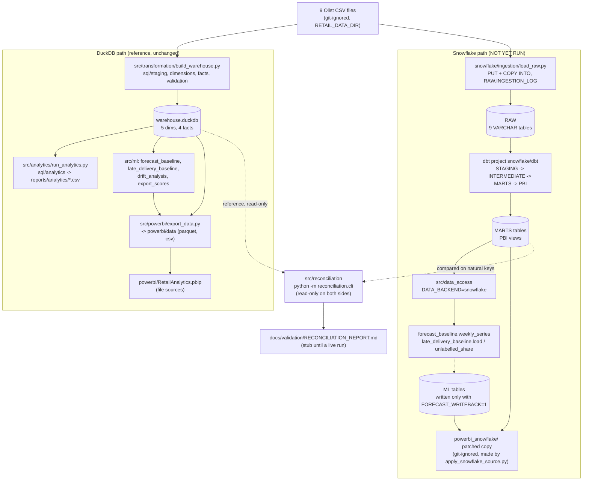
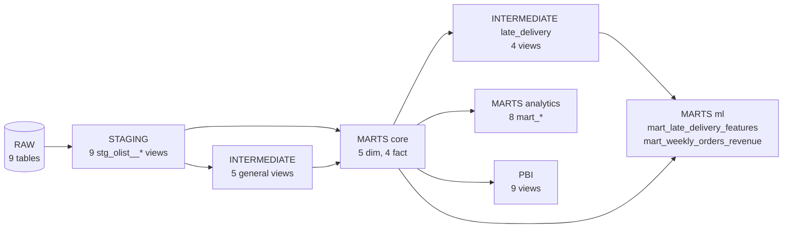
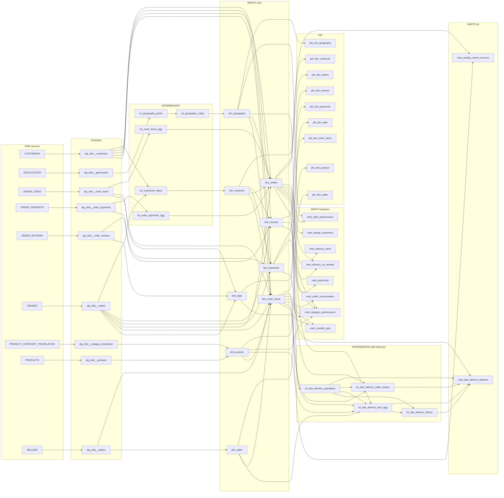
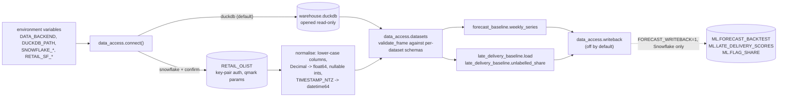
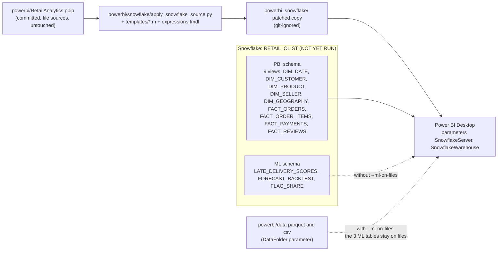

# Snowflake + dbt architecture

> **Live status (2026-11-13):** this page was written before the live run and its body is kept as the design record. The pipeline has since run on Snowflake: setup and RAW load (counts exact, no stray carriage returns), `dbt build` PASS=367 including the `ASOF JOIN`, reconciliation 22/22 with 0 differences, and the Tier 1 Python models. Not run: the ML write-back and the Power BI patched copy. Where this page says NOT YET RUN or UNVERIFIED about those steps, read [snowflake/README.md](../../snowflake/README.md) for the measured result.

Status as of 2026-11-06 on branch `feature/snowflake-dbt-migration`. This page describes what exists in the repository now. **Nothing on the Snowflake side has been run against a Snowflake account**: every box in the "Snowflake path" is built and tested offline only (fake connectors, `dbt parse`, a DuckDB logic simulation). Anything marked NOT YET RUN is unproven. The DuckDB path is unchanged and is the reference.

Related pages: [SQL migration inventory](../migration/SNOWFLAKE_MIGRATION.md) | [data dictionary](../data_dictionary/DATA_DICTIONARY.md) | [setup runbook](../../snowflake/README.md) | [ingestion runbook](../migration/INGESTION_RUNBOOK.md) | [Power BI switch guide](../migration/POWERBI_SWITCH_GUIDE.md) | [live checks](../../snowflake/dbt/README_LIVE_CHECKS.md) | [reconciliation report (NOT RUN stub)](../validation/RECONCILIATION_REPORT.md)

## 1. End-to-end flow: DuckDB path and Snowflake path

The two paths start from the same nine CSV files and end at the same Power BI report. They share no runtime state: the Snowflake path never reads or writes `warehouse.duckdb`, and the DuckDB path never contacts Snowflake. The only link between them is the reconciliation tool, which reads the DuckDB file read-only and the Snowflake marts and compares them.

Notes on the diagram:
- The DuckDB boxes are the pre-existing, tested pipeline. The Snowflake boxes are new.
- `src/data_access` selects the backend from `DATA_BACKEND` (default `duckdb`). Importing it never imports the Snowflake connector and never opens a connection. A Snowflake connection needs the credentials in the environment and an explicit `confirm=True` (or `RETAIL_SF_CONFIRM=1`); before connecting it prints the resolved account, database, role and warehouse.
- The `main()` entry points of `forecast_baseline.py` and `late_delivery_baseline.py` still open DuckDB directly. Tier 1 modules (`forecast_baseline`, `late_delivery_baseline`) accept a `data_access` connection, but there is no `--backend` flag yet. `drift_analysis`, `export_scores`, `export_data`, `run_analytics`, `mockup_data` and the notebooks are DuckDB-only.
- The reconciliation tool compares the five dimensions, four facts, the eight analytics marts, the late-delivery feature table (including per-column aggregates) and the weekly series, plus the headline numbers. Its report is written only after a live run; the committed file is a stub that says NOT RUN.
- CI workflow files are present under `.github/workflows/` in the working tree. They were written by another workstream and are not described or reviewed here.

## 2. Snowflake objects and roles

Defined in `snowflake/setup/01_objects.sql` and `02_grants.sql` (idempotent `CREATE ... IF NOT EXISTS`, additive `GRANT`s, no `OR REPLACE` or `DROP`). **Not run**: the read-only `00_preflight.sql` must be run and approved first.

| Object | Name | Notes |
|---|---|---|
| Database | `RETAIL_OLIST` | one database for all layers |
| Schemas | `RAW`, `STAGING`, `INTERMEDIATE`, `MARTS`, `PBI`, `ML` | dbt dev/ci targets write to `<DBT_DEV_SUFFIX>_<SCHEMA>` instead (default prefix `DBT_DEV`, `DBT_CI` for the ci target) |
| Warehouse | `RETAIL_WH` | `XSMALL`, auto-suspend 60 s, created suspended |
| Roles | `RETAIL_LOADER`, `RETAIL_TRANSFORMER`, `RETAIL_REPORTER` | single-role fallback documented in `01_objects.sql` |

| Role | Can do |
|---|---|
| `RETAIL_LOADER` | create tables, stage and file format in `RAW`; select, insert, truncate on `RAW` tables |
| `RETAIL_TRANSFORMER` | read `RAW`; create tables and views in `STAGING`, `INTERMEDIATE`, `MARTS`, `PBI`, `ML`; select, insert, update, delete on `ML` tables; `CREATE SCHEMA` on the database (dbt dev target only, flagged for approval) |
| `RETAIL_REPORTER` | select on the `PBI` views and tables and on the `ML` tables |

Inside `RAW`: nine landing tables named after the CSV files (`CUSTOMERS`, `GEOLOCATION`, `ORDER_ITEMS`, `ORDER_PAYMENTS`, `ORDER_REVIEWS`, `ORDERS`, `PRODUCTS`, `SELLERS`, `PRODUCT_CATEGORY_TRANSLATION`) with every business column `VARCHAR` plus `_loaded_at`, `_source_file`, `_source_row_number`, `_batch_id`; the file format `OLIST_CSV`, the internal stage `OLIST_STAGE` and the table `INGESTION_LOG`.

## 3. dbt layers and lineage

The dbt project is in `snowflake/dbt` (dbt-core and dbt-snowflake 1.11, isolated environment on Python 3.13, key-pair authentication from environment variables only). Materialisation and schema come from the folder: staging, intermediate and PBI are views; marts are tables.

| Layer | Folder | Schema (prod) | Materialisation | Models |
|---|---|---|---|---|
| Sources | `models/staging/_sources.yml` | `RAW` | - | 9 tables, source name `olist_raw` |
| Staging | `models/staging` | `STAGING` | view | 9 `stg_olist__*` |
| Intermediate | `models/intermediate` | `INTERMEDIATE` | view | 5 general + 4 under `late_delivery/` |
| Core marts | `models/marts/core` | `MARTS` | table | 5 `dim_*`, 4 `fact_*` (same names as DuckDB) |
| Analytics marts | `models/marts/analytics` | `MARTS` | table | 8 `mart_*` (one per `sql/analytics/NN_*.sql`) |
| ML marts | `models/marts/ml` | `MARTS` | table | `mart_late_delivery_features`, `mart_weekly_orders_revenue` |
| Power BI views | `models/pbi` | `PBI` | view | 9 `pbi_*` models, aliased to `DIM_DATE` ... `FACT_REVIEWS` |

Cross-cutting pieces: macros `generate_schema_name` (prod: plain upper-case schema; dev/ci: prefixed), `iso_week_start`, `date_key`; 39 singular tests plus generic tests in the YAML (they replace the PK/FK constraints DuckDB enforces); the `late_delivery_history_method` variable (`asof` default, `range_join` fallback) in `int_late_delivery_history`.

### 3.1 Layer overview

The late-delivery intermediates are built on the core marts (not on staging), which is why they sit after `MARTS core` here. The analytics marts, the weekly series and the PBI views read only the core marts.

The exact model-level dependencies are in the next diagram. In addition, the singular test `assert_pbi_views_match_core_marts` reads the PBI views and the core marts to check that they agree; tests are not drawn as lineage edges.

### 3.2 Model-level lineage (generated from the dbt manifest)

Generated by `python scripts/render_data_dictionary.py --manifest <manifest.json> --lineage` from the manifest that `dbt parse --target prod` wrote (46 models, 9 sources). Edges are `ref`/`source` dependencies only. Regenerate it whenever the models change.

## 4. Python integration

What each Snowflake read does (from `src/data_access/datasets.py`):

| Dataset | Used by | Snowflake source | Order |
|---|---|---|---|
| `weekly_series` | `forecast_baseline.weekly_series` | `MARTS.mart_weekly_orders_revenue` | `ORDER BY week` |
| `late_delivery_features` | `late_delivery_baseline.load` | `MARTS.mart_late_delivery_features` | explicit column list, `ORDER BY purchase_ts, order_id` |
| `unlabelled_share` | `late_delivery_baseline.unlabelled_share` | `MARTS.fact_orders` (no dedicated mart) | grouped by month, returned as a dict (no `ORDER BY`) |

Behaviour that is guarded in code and covered by offline tests with a fake connector (never against a live account):
- default backend `duckdb`; an invalid `DATA_BACKEND` raises; the DuckDB connection is read-only and honours `DUCKDB_PATH`;
- a Snowflake connect without confirmation does not import the connector, read a key or connect; secrets are never printed;
- results are normalised to the DuckDB dtypes and checked with `validate_frame` (missing columns and wrong kinds fail);
- write-back is off unless `FORECAST_WRITEBACK=1` (or `enabled=True`), refuses a non-Snowflake backend, validates before any SQL, and issues only `CREATE TABLE IF NOT EXISTS`, `DELETE ... WHERE run_id = ?` and a `write_pandas` append. The delete and the insert are not one transaction (re-run with the same `run_id` after a failure). The `ML` tables carry an extra leading `run_id` column that the export files do not have.

Reconciliation (`src/reconciliation`) has its own injectable fetcher and does not go through `data_access`, because converting `Decimal` to float would turn the exact-money comparison into a float comparison. It sends only single `SELECT`/`WITH` statements and refuses to run without `--yes`.

## 5. Power BI integration

- The script copies the project, then rewrites only `definition/expressions.tmdl` and the `source` block of each of the 12 import-table partitions. The report folder, relationships, measures and column definitions are copied byte for byte; offline tests assert this and that the original project is never modified.
- Each M template navigates `Snowflake.Databases(SnowflakeServer, SnowflakeWarehouse)` > `RETAIL_OLIST` > `PBI` (or `ML`) > object, lower-cases the column names and applies the table's existing `Table.TransformColumnTypes` step. The `PBI` objects are read as `Kind="View"` and the `ML` objects as `Kind="Table"`.
- The `PBI` views expose exactly the columns, order and types that `src/powerbi/export_data.py` writes, including the derived `is_net_order`, `is_labelled_delivery`, `promised_days`, `delay_bucket` and `delay_bucket_order`. `DIM_DATE` omits the `-1` row and `FACT_REVIEWS` omits comment text, as the export does.
- UNVERIFIED: that Power BI Desktop opens the patched copy, the authentication option, and the M navigation. None of it has been run. `powerbi_snowflake/` was not yet in `.gitignore` when this page was written; add it before creating a patched copy because the copy will hold your account name.

## 6. Design decisions that shape the architecture

- **Alongside, not instead.** The DuckDB implementation stays the tested reference; the Snowflake implementation is added next to it and compared against it name for name (`dim_*`, `fact_*`, the eight analytics marts).
- **RAW is untyped.** All columns are `VARCHAR` with load metadata, so typing, renaming and empty-string handling live in dbt staging views (`cast(nullif(col, ''), ...)`), where they are visible and tested.
- **Tests replace constraints.** Snowflake does not enforce keys; uniqueness, not-null and referential integrity (including the `-1` unknown members) are dbt tests.
- **Explicit live gates.** The preflight is read-only; every live command prints its target and needs `--yes` (loader, reconciliation) or `confirm` (Python); nothing connects during `dbt parse`, tests or imports.
- **Deterministic tie-breaks.** Where the DuckDB SQL relies on an arbitrary pick (`arg_max`), the Snowflake models use an alphabetical rule; the differences are expected, counted and labelled in reconciliation (see the migration inventory, section 8).
- **Isolated tooling.** dbt has its own environment under `snowflake/dbt` so the repository root stays on its own Python version and lock.
