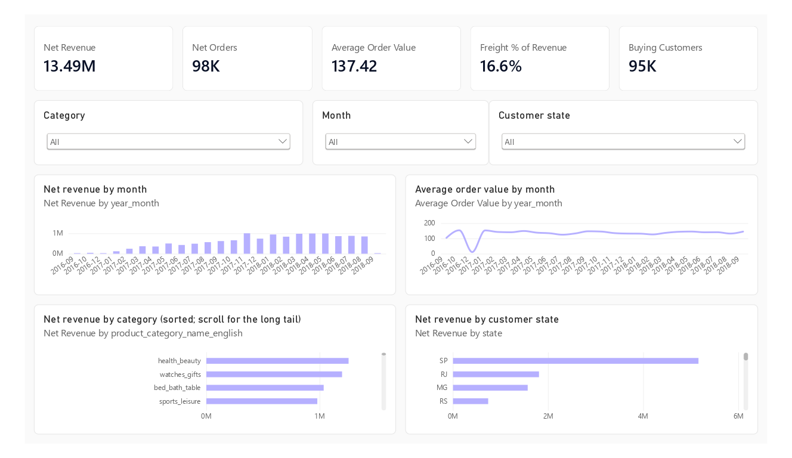
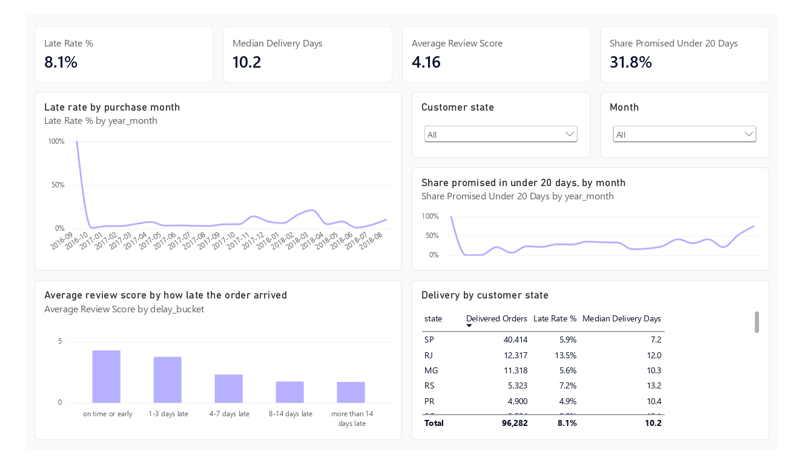
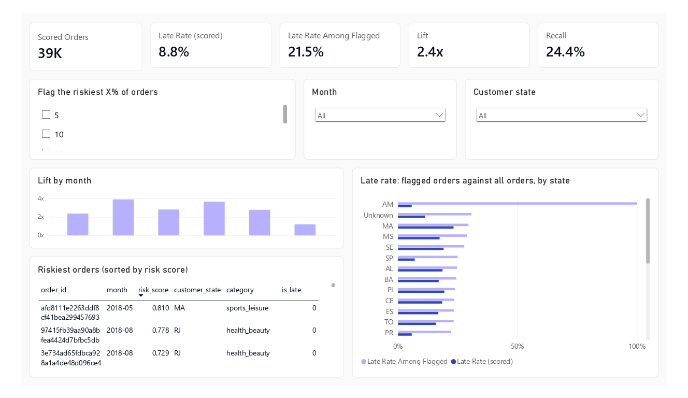
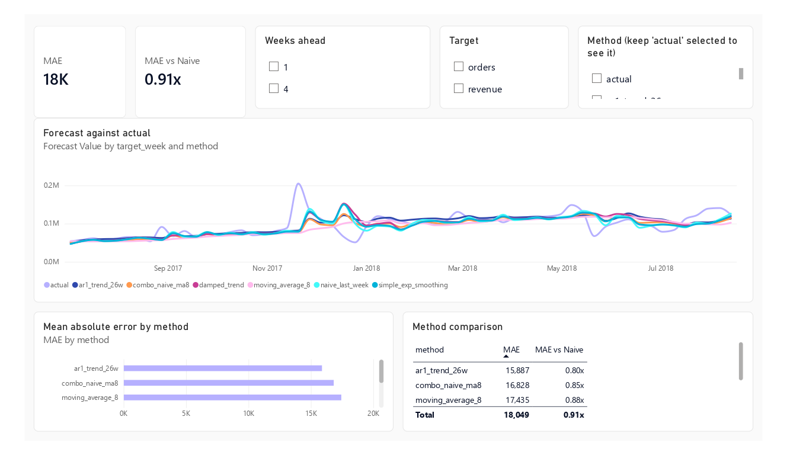

# Power BI project

A four-page dashboard over the local warehouse: sales overview, delivery and reviews, late-delivery risk, weekly forecast.
It is delivered as a Power BI Project (`RetailAnalytics.pbip`), built from the same definition as the two HTML documents
in [docs/powerbi/](../docs/powerbi/):

| File | What it is |
|---|---|
| [DAX_SPECIFICATION.html](../docs/powerbi/DAX_SPECIFICATION.html) | The specification: model, relationships, 38 measures with DAX, the SQL each mirrors and its expected value, page layouts, first-open checklist |
| [DASHBOARD_MOCKUP.html](../docs/powerbi/DASHBOARD_MOCKUP.html) | An interactive picture of the finished dashboard with real numbers (open it in any browser; not Power BI) |
| `RetailAnalytics.pbip` | The project: `RetailAnalytics.SemanticModel/` (tables, relationships, measures as TMDL) and `RetailAnalytics.Report/` (pages and visuals as PBIR) |

## Screenshots

The four pages, rendered from the mock-up with the same numbers as the dashboard:



*Sales overview — net revenue, net orders, average order value, freight % of revenue and buying customers, with revenue by month, category and customer state.*



*Delivery and reviews — late rate, median delivery days, average review score, share promised under 20 days, review score by delay bucket and delivery by customer state.*



*Late-delivery risk — lift and recall when flagging the riskiest X% of orders, lift by month, the riskiest orders and late rate by state.*



*Weekly forecast — forecast against actual by method, mean absolute error by method and the method comparison.*

**Status: opens and loads in Power BI Desktop.** Two first-open problems were found and fixed (see below), and the committed files are now the ones Desktop saved, so **Desktop owns the report and model from here**: edit them there.  The project was generated on a machine without Desktop. On the first open Desktop rejected it with "The 'Forecast' measure cannot be created because a column with the same name already exists" (Power BI compares names ignoring case, and the table had a column `forecast`). The measures `Forecast` and `Actual` are now `Forecast Value` and `Actual Value`, and a test checks names ignoring case. Desktop reports one model error at a time, so another may still appear; the report pages have not been confirmed to load either.
What was checked instead: every JSON file validates against Microsoft's published schemas, every table, column and measure
named anywhere exists, and the exported data reproduces the warehouse figures (`tests/test_powerbi_project.py`,
`tests/test_powerbi_export.py`). That does not prove Desktop will accept every file. If it shows an error on first open,
send the exact message and the file it names.

## Open it

1. Install **Power BI Desktop** (free, Windows), a recent version. If it does not offer to open `.pbip` files, enable *File > Options and settings > Options > Preview features > Power BI Project (.pbip) save option*, and the PBIR enhanced report format if listed, then restart.
2. Create the data files (they are not committed; they derive from the CC BY-NC-SA Olist data):
   ```
   uv run python src/transformation/build_warehouse.py     # if warehouse.duckdb does not exist yet
   uv run python src/powerbi/export_data.py                # writes powerbi/data/ (Parquet and CSV, about 40 MB)
   ```
3. Open `powerbi/RetailAnalytics.pbip`.
4. Set the data location once: *Home > Transform data > Manage parameters > DataFolder*, enter the **full path to
   `powerbi/data`** (for example `C:\Users\you\GCP\powerbi\data`, no trailing backslash), then *Close & Apply*. Until you do
   this the tables stay empty or show a "file not found" error.
5. Run the **first-open checklist** at the end of the specification: about a dozen headline numbers (net revenue R$ 13,494,400.74,
   98,199 net orders, 8.13% late, 21.5% late among the riskiest 10%, and so on) to compare with the cards. If they match, the
   measures and relationships are right.

## Optional

- The colour theme is in `theme/RetailAnalytics.theme.json` (*View > Themes > Browse for themes*). The report already uses the
  built-in base theme, so this is only for matching the project palette.
- Nothing in the project holds credentials. The only machine-specific setting is the `DataFolder` path, which Desktop keeps in
  the model and which is not committed (the committed value is a placeholder).

## Regenerate (only to start over)

The files under `RetailAnalytics.*` and `docs/powerbi/*.html` are generated; edit `src/powerbi/model_spec.py` and re-run, not the files.

```
uv run python src/powerbi/build_spec_html.py
uv run python src/powerbi/build_mockup_html.py
uv run python src/powerbi/build_pbip.py
```

`build_pbip.py` now refuses to run while a project exists, because regenerating would overwrite every change made in Desktop; `--force` overrides that. The generator is a scaffold that produced the first version, and `model_spec.py` still drives the specification and mock-up, which will drift from the project as you change it in Desktop.

**Do not commit your local data path.** Desktop writes the `DataFolder` you entered into `RetailAnalytics.SemanticModel/definition/expressions.tmdl`. The committed value is the placeholder; after you enter your path, run `git update-index --skip-worktree powerbi/RetailAnalytics.SemanticModel/definition/expressions.tmdl` so Git ignores your local change (undo with `--no-skip-worktree`).

## If the first refresh fails

Power BI reports the first failing table and marks the rest "Load was cancelled by an error in loading a previous table" (and some as an OLE DB error 0x80040E4E), so fix the first message only. Known case: `dim_date` contained a "Not applicable" row with an empty date, which cannot be in a date table's key; the export now leaves it out, so re-run `export_data.py` and use *Home > Refresh*. Facts that have no date (for example the delivery date of an order that was never delivered) show as (Blank) in date slicers, which is intended.

## Known limits

- Row-level **review comments are not exported**; only the score and whether a comment exists.
- The risk page uses out-of-time scores for 2018-03 to 2018-08 only (the test months of the model); other months show no scores.
- Scores are for ranking, not probabilities (see `docs/ml/MODEL_CARD.md`).
- Measures were written to mirror the SQL, but DAX results have not been computed here; the checklist is how to confirm them.
