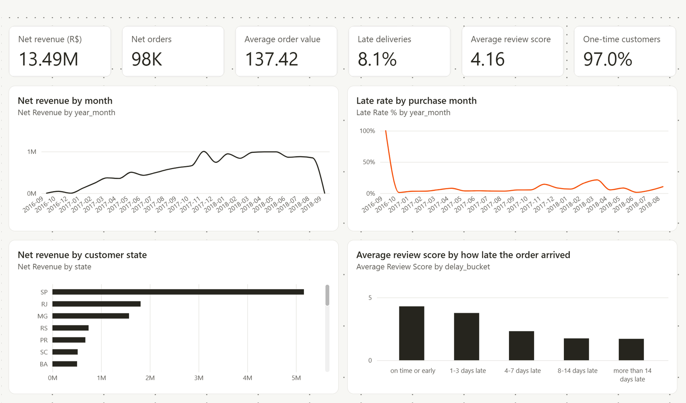
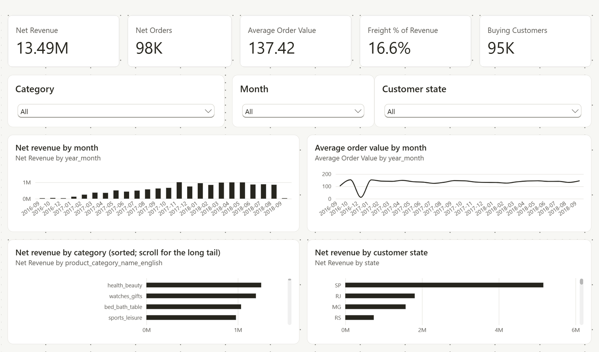
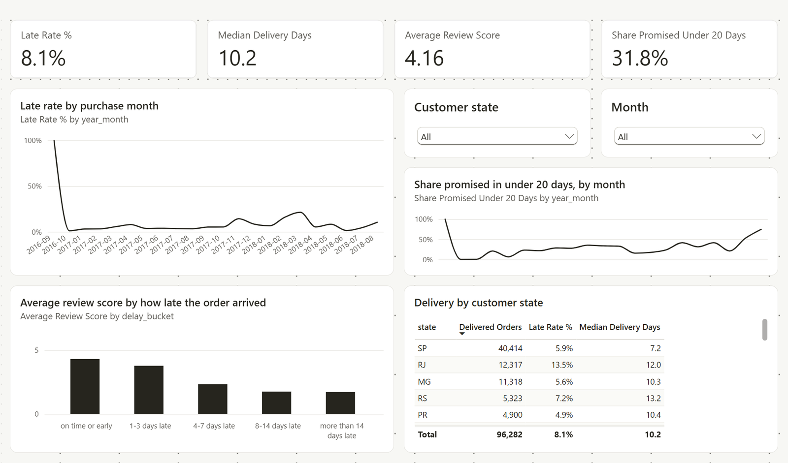
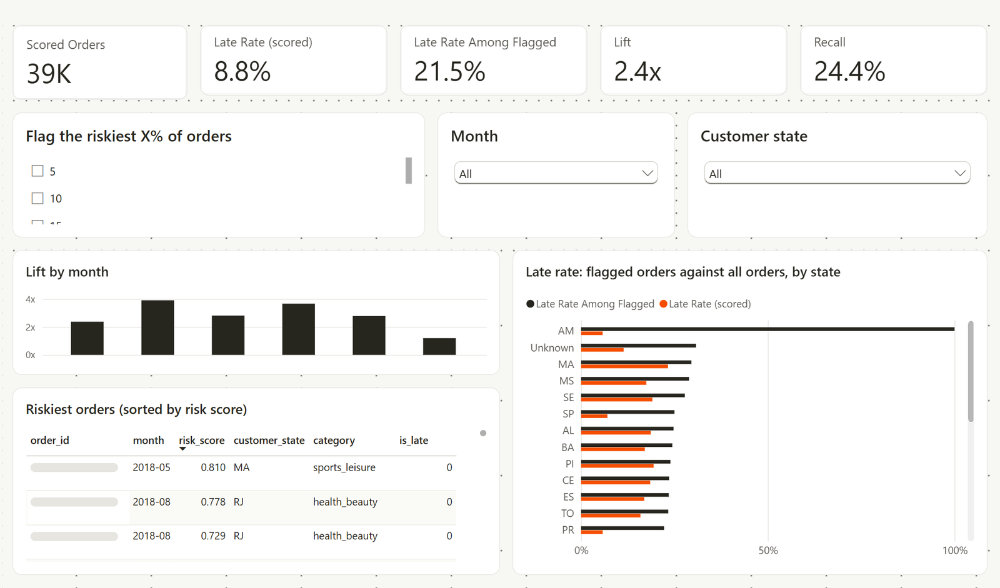
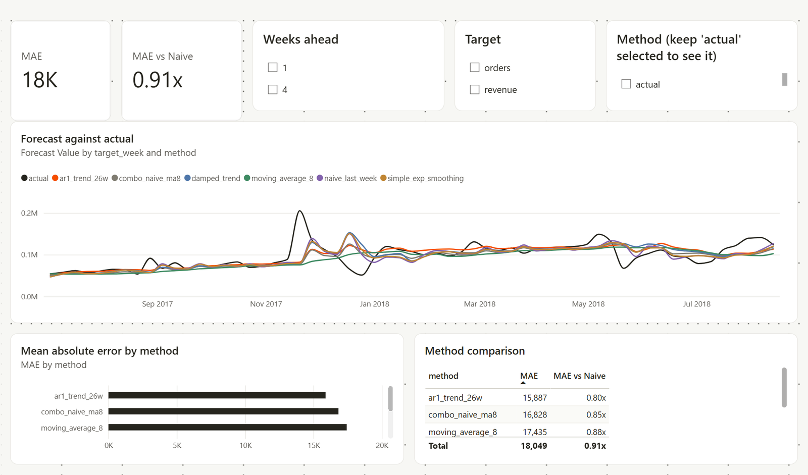

# Power BI project

A five-page dashboard over the Olist data: overview, sales, delivery and reviews, late-delivery risk, weekly forecast.
It is delivered as a Power BI Project (`RetailAnalytics.pbip`) that reads the exported files, plus a generated, git-ignored
copy (`powerbi_snowflake/`) that reads Snowflake instead (see [Use it with Snowflake](#use-it-with-snowflake)). The project was
first specified and pictured in two HTML documents built from the same definition, in [docs/powerbi/](../docs/powerbi/):

| File | What it is |
|---|---|
| [DAX_SPECIFICATION.html](../docs/powerbi/DAX_SPECIFICATION.html) | The specification: model, relationships, 38 measures with DAX, the SQL each mirrors and its expected value, page layouts, first-open checklist |
| [DASHBOARD_MOCKUP.html](../docs/powerbi/DASHBOARD_MOCKUP.html) | An interactive picture of the finished dashboard with real numbers (open it in any browser; not Power BI) |
| `RetailAnalytics.pbip` | The project: `RetailAnalytics.SemanticModel/` (tables, relationships, measures as TMDL) and `RetailAnalytics.Report/` (pages and visuals as PBIR) |

## Screenshots

The five pages as they render in Power BI Desktop with the theme below, on data read from Snowflake (2026-11-25). The order
ids in the risk table are replaced by grey bars in the image.



*Overview: net revenue, net orders, average order value, late deliveries, average review score and one-time customers, then net revenue and late rate by month (the late rate in orange), net revenue by customer state and review score by how late the order arrived.*



*Sales overview: net revenue, net orders, average order value, freight % of revenue and buying customers, with revenue by month, category and customer state, and category, month and state filters.*



*Delivery and reviews: late rate, median delivery days, average review score, share promised under 20 days, late rate by month, review score by delay bucket and delivery by customer state.*



*Late-delivery risk: lift and recall when flagging the riskiest X% of orders, lift by month, the riskiest orders and late rate by state.*



*Weekly forecast: forecast against actual by method, mean absolute error by method and the method comparison.*

**Status: opens and loads in Power BI Desktop, from the exported files and from Snowflake.** The project was generated on a machine
without Desktop and needed two fixes on its first open: Desktop rejected it with "The 'Forecast' measure cannot be created because a
column with the same name already exists" (Power BI compares names ignoring case), so the measures `Forecast` and `Actual` are now
`Forecast Value` and `Actual Value` and a test checks names ignoring case; and an empty key row in the date table (see "If the first
refresh fails"). The committed files are now the ones Desktop saved, so **Desktop owns the report and model from here**: edit them
there. On 2026-11-25 the Snowflake copy was opened and signed in, all five pages loaded, and the headline figures on them (R$ 13.49M
net revenue, 98K net orders, 8.1% late) agree with the first-open checklist.

Before Desktop was available the checks were: every JSON file of the generated project validates against Microsoft's published
schemas, every table, column and measure named anywhere exists, and the exported data reproduces the warehouse figures
(`tests/test_powerbi_project.py`, `tests/test_powerbi_export.py`). Those do not prove Desktop accepts every file; if it shows an error
on open, send the exact message and the file it names.

## Theme and the Overview page (2026-11-25)

The report theme is `RetailAnalytics.Report/StaticResources/RegisteredResources/CursorTheme-<id>.json`, adapted from a design
brief (`DESIGN-cursor.md`: warm cream canvas, white cards with a 1px hairline and 12px corners, no shadows, warm near-black
ink, one orange accent). It also sets the page canvas and wallpaper, card, chart-axis, slicer and table styles, so a change
to the theme file changes every page. What was decided where the brief did not reach:

| Decision | Choice and reason |
|---|---|
| Fonts | Segoe UI and Segoe UI Semibold. The brief's CursorGothic is licensed and its substitute (Inter) is not installed on a default Windows machine, and Power BI cannot embed fonts. Change `fontFace` / `fontFamily` in the theme if you install Inter. Letter-spacing cannot be set in Power BI |
| Series colours | Ink first, orange second (so the one series to look at is orange: the forecast, the flagged orders, the late rate), then muted warm grey and four deepened hues for charts with many series. The brief reserves its pastel timeline colours for a different purpose, and they are too light for chart marks on white. Every chart colour is at least 3:1 against white, text at least 7:1 |
| Per-visual overrides | The cards and slicers hid their own background and border, which beats the theme. Those `background`, `border` and `dropShadow` overrides were removed from 22 visuals so the theme applies |
| Overview page | New first page, cloned from existing visuals using only tables and measures already in the model: six KPI cards, net revenue and late rate by month, net revenue by state, review score by delay |

When you change the theme file, rename it with a new short id (`CursorTheme-<new id>.json`) and update the three references
in `definition/report.json`; Desktop caches themes by file name. `powerbi-report-author validate powerbi/RetailAnalytics.Report`
checks the result. Two errors remain that were there before: `.pbip` and `definition.pbir` have no `$schema` line (Desktop
wrote them that way).

## Use it with Snowflake

The Snowflake copy is generated, git-ignored and holds your account address, so it is never committed.

1. Write the copy: `.\.venv\Scripts\python.exe powerbi\snowflake\apply_snowflake_source.py` (it refuses to overwrite an existing copy; `--force` replaces it and resets the parameters below).
2. Open `powerbi_snowflake/RetailAnalytics.pbip` and set two parameters (*Home > Transform data > Manage parameters*): `SnowflakeServer` is your account address, `<account>.snowflakecomputing.com`, not the database name (`RETAIL_OLIST`) and not the repository name; `SnowflakeWarehouse` is `RETAIL_WH`.
3. Sign in with a Snowflake user whose default role is `RETAIL_REPORTER`. If sign-in fails with `Failed to parse PEM block containing the private key`, type the user name and password again in *File > Options and settings > Data source settings*, for both the current file and the global permissions.
4. Change the design in `powerbi/`, commit it there, then regenerate the copy. A change made only in the copy is not in Git.

The full guide, with the table-to-view mapping and what is still unverified, is [docs/migration/POWERBI_SWITCH_GUIDE.md](../docs/migration/POWERBI_SWITCH_GUIDE.md).

## Open it

1. Install **Power BI Desktop** (free, Windows), a recent version. If it does not offer to open `.pbip` files, enable *File > Options and settings > Options > Preview features > Power BI Project (.pbip) save option*, and the PBIR enhanced report format if listed, then restart.
2. Create the data files (they are not committed; they derive from the CC BY-NC-SA Olist data):
   ```
   uv run python src/transformation/build_warehouse.py     # if warehouse.duckdb does not exist yet
   uv run python src/powerbi/export_data.py                # writes powerbi/data/ (Parquet and CSV, about 40 MB)
   ```
3. Open `powerbi/RetailAnalytics.pbip`.
4. Set the data location once: *Home > Transform data > Manage parameters > DataFolder*, enter the **full path to
   `powerbi/data`** (for example `C:\Users\you\GCP\powerbi\data`, no trailing backslash), then *Close & Apply*. Until you do
   this the tables stay empty or show a "file not found" error.
5. Run the **first-open checklist** at the end of the specification: about a dozen headline numbers (net revenue R$ 13,494,400.74,
   98,199 net orders, 8.13% late, 21.5% late among the riskiest 10%, and so on) to compare with the cards. If they match, the
   measures and relationships are right.

## Optional

- The report carries its own theme (see "Theme and the Overview page"). `theme/RetailAnalytics.theme.json` is the original optional
  palette written by the generator; the report does not use it.
- Nothing in the project holds credentials. The only machine-specific setting is the `DataFolder` path, which Desktop keeps in
  the model and which is not committed (the committed value is a placeholder).

## Regenerate (only to start over)

The files under `RetailAnalytics.*` and `docs/powerbi/*.html` are generated; edit `src/powerbi/model_spec.py` and re-run, not the files.

```
uv run python src/powerbi/build_spec_html.py
uv run python src/powerbi/build_mockup_html.py
uv run python src/powerbi/build_pbip.py
```

`build_pbip.py` now refuses to run while a project exists, because regenerating would overwrite every change made in Desktop; `--force` overrides that. The generator is a scaffold that produced the first version, and `model_spec.py` still drives the specification and mock-up, which will drift from the project as you change it in Desktop.

**Do not commit your local data path.** Desktop writes the `DataFolder` you entered into `RetailAnalytics.SemanticModel/definition/expressions.tmdl`. The committed value is the placeholder; after you enter your path, run `git update-index --skip-worktree powerbi/RetailAnalytics.SemanticModel/definition/expressions.tmdl` so Git ignores your local change (undo with `--no-skip-worktree`).

## If the first refresh fails

Power BI reports the first failing table and marks the rest "Load was cancelled by an error in loading a previous table" (and some as an OLE DB error 0x80040E4E), so fix the first message only. Known case: `dim_date` contained a "Not applicable" row with an empty date, which cannot be in a date table's key; the export now leaves it out, so re-run `export_data.py` and use *Home > Refresh*. Facts that have no date (for example the delivery date of an order that was never delivered) show as (Blank) in date slicers, which is intended.

## Known limits

- Row-level **review comments are not exported**; only the score and whether a comment exists.
- The risk page uses out-of-time scores for 2018-03 to 2018-08 only (the test months of the model); other months show no scores.
- Scores are for ranking, not probabilities (see `docs/ml/MODEL_CARD.md`).
- The measures mirror the SQL. The headline figures on the Snowflake-backed pages agree with the first-open checklist; the rest of the checklist was compared by the owner, and no test in this repository computes DAX.
- The late-rate charts start with a 100% spike: the first month (2016-09) has only a few orders and months under 500 orders are not filtered out.
